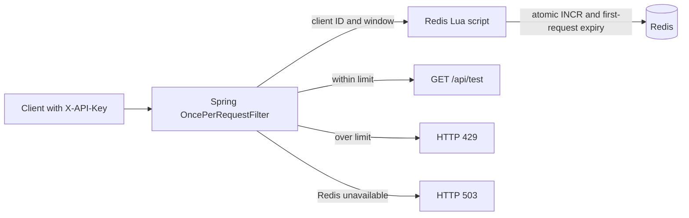

# API Rate Limiter

A small Spring Boot API that applies a Redis-backed fixed-window request limit per API key. Every `/api/**` request passes through the limiter.

## Architecture



## Run locally

Requirements: Java 21 and Docker Desktop.

```powershell
docker compose up -d
.\mvnw.cmd spring-boot:run
```

The default policy allows 10 requests per client per 60-second, epoch-aligned window. Override it with `RATE_LIMIT_REQUESTS` and `RATE_LIMIT_WINDOW_SECONDS`.

```powershell
curl.exe -i -H "X-API-Key: demo-client" http://localhost:8080/api/test
```

Repeat the `curl.exe` request 11 times in the same window to see the default limit reject the last request. The health endpoint is `http://localhost:8080/actuator/health`.

Requests over the limit receive HTTP 429 and `Retry-After`. Rate-limit responses include `X-RateLimit-Limit`, `X-RateLimit-Remaining`, and `X-RateLimit-Reset` (Unix epoch seconds). Missing API keys receive HTTP 400. If Redis is unavailable, protected API requests fail closed with HTTP 503.

## Design notes

- The API key is used as a client identifier, not validated as an authentication credential.
- Redis stores a counter per hashed client key and fixed-window number. Hashing keeps raw API keys out of Redis key names.
- One Lua script performs `INCR` and sets expiry on the first increment. Redis executes the script atomically, preventing concurrent requests from racing between increment and expiry setup.
- Fixed windows are simple and inexpensive, but clients can make a burst around a window boundary.
- The policy is shared by application instances that point to the same Redis server. Redis remains a dependency: this version rejects protected calls with 503 during Redis failures.
- A fixed window can allow a boundary burst: 10 requests just before a window ends and 10 more just after it begins.

## Interview notes

- **Why Redis instead of an in-process map?** One local map per application process would create separate counts. Redis gives all app instances a shared counter store and expiry mechanism.
- **Why use a Lua script?** `INCR` is atomic, but issuing `INCR` and `EXPIRE` separately leaves a gap where a process failure could leave a counter without expiry. Redis runs the script as one atomic operation.
- **What if two app instances receive requests at once?** Both call the same Redis script against the same client/window key. Redis serializes command execution, so each request receives a distinct counter value and only the first `limit` values pass.
- **What are the fixed-window trade-offs?** It is easy to explain and cheap to store, but can permit a burst on a window boundary. A sliding window or token bucket smooths bursts with more state or logic.
- **Why fail closed when Redis is down?** Returning 503 avoids silently bypassing protection. A service that prioritizes availability could fail open, but would accept unmetered requests during the outage.
- **What does the API key prove?** Nothing beyond a caller-provided identifier in this version. Production authentication would require issuing and validating credentials, handling rotation, and protecting keys in transit and storage.

## Configuration

| Environment variable | Default | Meaning |
| --- | ---: | --- |
| `RATE_LIMIT_REQUESTS` | `10` | Maximum requests per client in one window |
| `RATE_LIMIT_WINDOW_SECONDS` | `60` | Window duration in seconds |
| `REDIS_HOST` | `localhost` | Redis hostname |
| `REDIS_PORT` | `6379` | Redis port |

The window aligns to epoch time. For example, with a 60-second window, all requests during one UTC minute share a counter. `X-RateLimit-Reset` is the Unix timestamp for the end of that window, while `Retry-After` is the number of seconds to wait after a rejected request.

## Tests

Unit tests cover limits, independent clients, window boundaries, missing API keys, accepted requests, and HTTP 429 headers. Testcontainers integration tests verify Redis TTL expiry and send 100 concurrent requests to real Redis, expecting exactly 10 to pass. The Redis tests are skipped when Docker is unavailable.

```powershell
.\mvnw.cmd test
```
